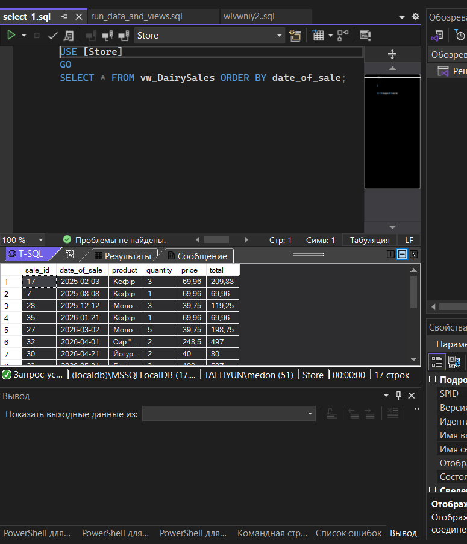
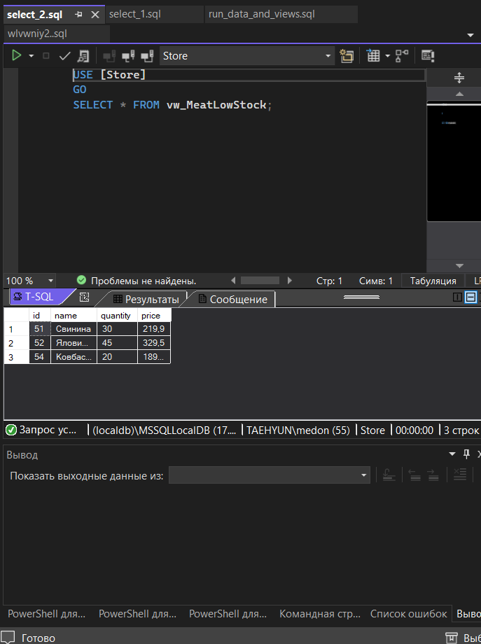
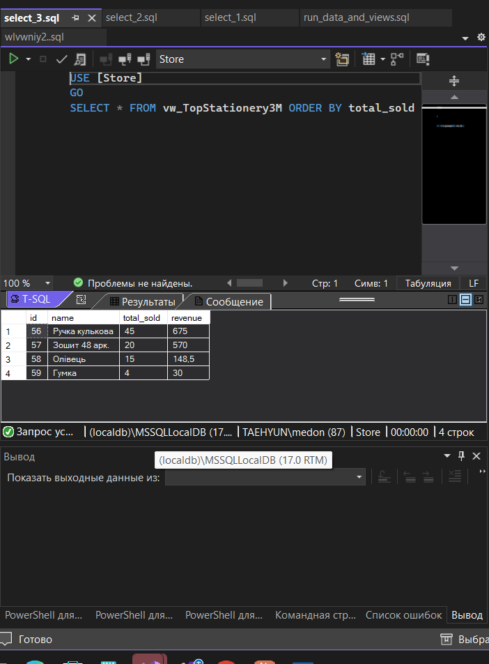
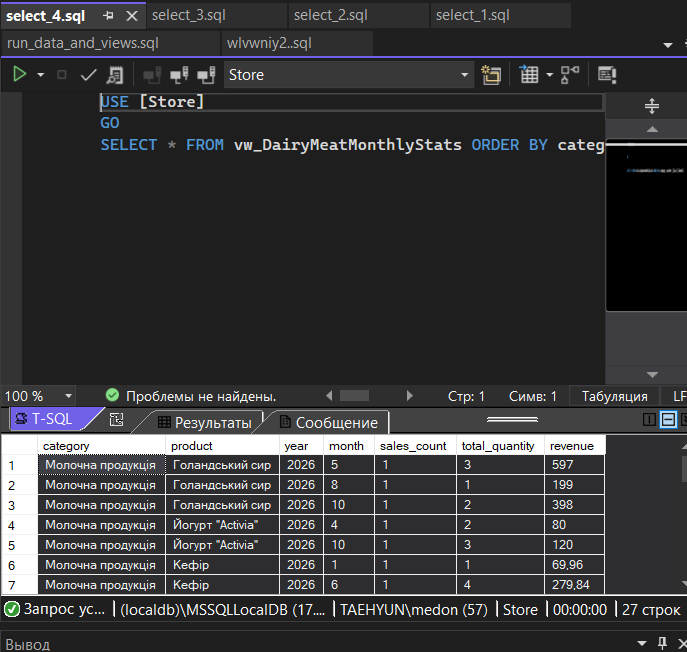
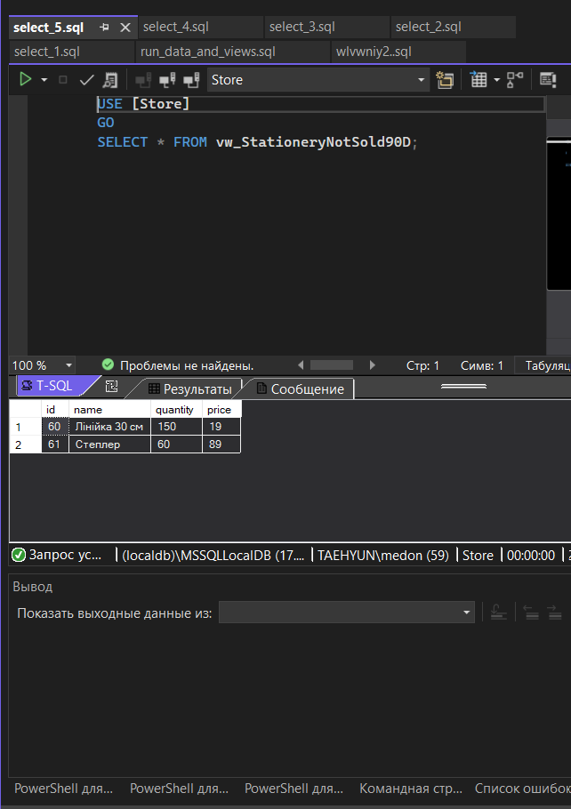

# Store — представлення (VIEW)

База даних: `Store` (MS SQL Server, LocalDB).

## Файли

| Файл | Опис |
|---|---|
| `3_views.sql` | Створення 5 вью |
| `2_data.sql` | Додані дані: відділи "М'ясо" і "Канцтовари", товари та продажі |
| `1_molochka_sales.png` … `5_kanc_not_sold_90d.png` | Результати вью |

> У вихідній базі не було відділів "М'ясо" і "Канцтовари", тому вони додані скриптом `2_data.sql`.
> Відділ "Молочка" в базі називається "Молочна продукція".

## Вью

1. **vw_DairySales** — всі продажі продуктів з відділу "Молочка".
   

2. **vw_MeatLowStock** — продукти з категорії "М'ясо", яких на складі менше 50 одиниць.
   

3. **vw_TopStationery3M** — найбільш продавані товари з відділу "Канцтовари" за останні 3 місяці.
   

4. **vw_DairyMeatMonthlyStats** — статистика продажів "Молочка" і "М'ясо" по місяцях за останній рік.
   

5. **vw_StationeryNotSold90D** — товари з "Канцтовари", які не продавались за останні 90 днів.
   

## Запуск

1. Виконати скрипт БД викладача (створює `Store`).
2. Виконати `2_data.sql`.
3. Виконати `3_views.sql`.
4. `SELECT * FROM vw_DairySales;` і т.д.
